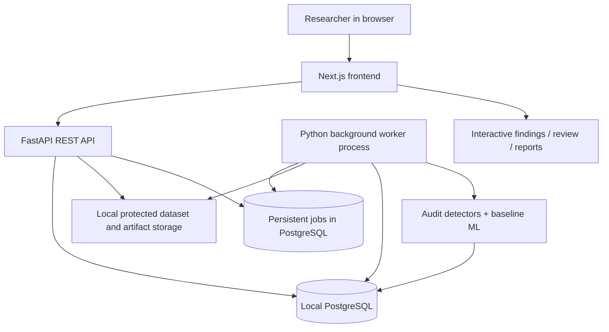

# MedData Forensics
## Complete research-backed product, architecture and experimental blueprint

**Prepared:** 12 November 2026  
**Status:** Design/research specification — no software implementation, trained model, experimental outcome, deployment or clinical validation is claimed.  
**Intended use:** Software-only research support and dataset quality assurance. Not patient diagnosis, regulatory compliance certification, or authorization for clinical care.

---

## 1. Project charter

**Mission:** Build a local-first full-stack application that imports biomedical image datasets, detects potential integrity and quality risks, connects every finding to reproducible evidence, supports human review, and measures consequences for model performance on untouched evaluation data.

**Primary persona:** Biomedical AI researcher evaluating labeled image datasets. **Secondary persona:** ML engineer, research auditor or dataset curator.

**Primary hypothesis:** An impact-guided, evidence-backed triage strategy can help reviewers discover more consequential, correctly identified dataset issues for a fixed review budget than conventional heuristics, random review, or confidence-only ranking.

**What is *not* claimed:** That automatically flagged labels are medically incorrect; that a near-duplicate necessarily represents the same person; that a model attention heatmap proves shortcut learning; that removal of data always improves performance; that results imply clinical safety.

**Project boundaries:** Start with 2D single-label image classification and image+CSV/NPZ import. Treat multi-label, DICOM, 3D, biosignals, production cloud deployment, clinical PHI, unrestricted foundation models, and auto-relabeling as explicitly out of scope for the initial publication-grade study.

**Definition of done:** Working data import, persistent datasets and jobs, four auditable analysis families, reviewer decision workflow, independent downstream comparisons, repeatable experiment manifest, exportable report, passing tests, and honest documentation.

## 2. Relevant existing work and novelty position

| Prior art | Existing capability | What our research must *not* pretend is novel |
|---|---|---|
| Northcutt et al., *Confident Learning* (2021) | Estimates label noise / identifies suspected label errors | Suspect-label ranking alone |
| Cleanlab / Datalab | Labels, outliers, near-duplicates, dataset issue ranking | Combining ordinary detectors in a dashboard |
| MedMNIST-C (2025 proceedings / 2026 archive) | Task- and modality-specific image corruption benchmarks | Synthetic corruptions as a standalone contribution |
| G-AUDIT (2026, *npj Digital Medicine*) | Attribute utility/detectability for dataset shortcut risks | Generic shortcut-risk audit |
| 2026 public brain-MRI provenance study | Cross-dataset duplication / leakage and group-split inflation | Identifying duplicate leakage in isolation |
| CLAIM 2024 checklist | Reproducible reporting standards for imaging AI | CLAIM-based reporting by itself |

**Primary proposed novelty to test:** *Impact-Guided Audit Triage (IGAT)* — prioritize a human review queue by the combination of credible issue evidence, estimated downstream relevance, redundancy reduction, and review cost; compare against random, detector-confidence, fixed-rule severity and Cleanlab-derived baselines. The method and benefits are hypothetical until validated; implementation integration and a paper are not evidence of novelty.

**Practical mechanism:**
1. Generate candidate findings via established, separately benchmarked detectors.
2. Attach an evidence object (source images/IDs, hashes, similarity scores, split names, model/config versions, uncertainty).
3. Predict which candidate reviews could meaningfully affect model evaluation, using only training/cross-validation development data.
4. Rank candidates under a fixed human-review budget and discourage repeated near-identical recommendations.
5. Record reviewer-confirmed outcomes and independently measure issue-discovery yield, reviewer effort, and held-out downstream-model changes.

**Avoid a circular benchmark:** If issue ranking uses held-out test labels, patient identifiers from the untouched test beyond documented split checks, or post-intervention final results to select candidates, the claimed prospective ranking evaluation is invalid. Freeze candidate ranking and thresholds before final held-out assessment.

### Core literature and source URLs
- G-AUDIT, 2026: https://www.nature.com/articles/s41746-026-02807-y
- Confident Learning, 2021: https://research.google/pubs/confident-learning-estimating-uncertainty-in-dataset-labels/
- Cleanlab Datalab: https://docs.cleanlab.ai/stable/tutorials/datalab/datalab_quickstart.html
- MedMNIST-C: https://arxiv.org/abs/2406.17536
- Brain MRI dataset provenance study, 2026: https://pubmed.ncbi.nlm.nih.gov/42977830/
- CLAIM 2024: https://pubs.rsna.org/page/ai/claim
- CLAIM explanation, 2026: https://pubmed.ncbi.nlm.nih.gov/42813998/

## 3. Data acquisition and governance

### Recommended progression

| Stage | Resource | Use | Restrictions / caveats |
|---|---|---|---|
| A | DermaMNIST (10,015 samples) | CPU-friendly smoke tests; supervised label-suspicion evaluation; synthetic corruptions | 28/64/128 pixel variants offer limited detail; NPZ does not itself establish patient independence |
| B | PathMNIST reproducible subset (from 107,180 total) | Second modality / image domain | Predefine subset random seed and inclusion criteria; patch-level correlations may matter |
| C | HAM10000 (10,015 images) | Image hashing, lesion ID grouping, label reviews | Research/noncommercial terms; lesion ID is not a patient ID |
| D | ISIC 2020 metadata (33,126 records) and selected images | Patient+lesion split checks and official listed duplicates | Original training JPEG set ~23 GB; CC-BY-NC; don't assume locally accessible image subset without retrieval |

**Official sources:** https://medmnist.com/v2 ; https://doi.org/10.5281/zenodo.10519652 ; https://doi.org/10.7910/DVN/DBW86T ; https://challenge.isic-archive.com/data/

**License hygiene:** Retain source name, original citation, file-level attribution if required, usage terms, download date, and file hashes. MedMNIST component datasets may have source-specific terms; inspect each before redistribution. ISIC 2020 / HAM10000 noncommercial restrictions need care for a startup. Do not commit raw images, patient-level metadata or bundled downloaded datasets to public GitHub. Share scripts, provenance manifests and permitted derivatives instead.

**Dataset manifest format** (`dataset.yaml` + `samples.csv`):

```yaml
name: local_derma_audit
source: MedMNIST/DermaMNIST
source_url: https://medmnist.com/v2
license: "verify source terms before redistribution"
modality: dermoscopy
classification_type: single_label
schema_version: 1
split_policy: official
image_root: ./images
metadata_csv: ./samples.csv
label_column: label
sample_id_column: sample_id
split_column: split
group_id_column: null          # set to patient_id or lesion_id when actually present
source_site_column: null
seed: 42
```

**CSV minimum:** `sample_id,image_path,label,split`. Optional: `patient_id,lesion_id,site_id,acquisition_device,source_record_id`. Interpret every ID according to its documented meaning. Preserve official train/validation/test splits unless conducting a separately labeled grouping experiment.

**Data minimization:** Allow only confirmed, authorized, de-identified or synthetic data. Since biomedical imagery can contain identifying information, raw images remain in local files outside the frontend public directory. No remote telemetry or cloud inference. Never log file contents or sensitive metadata.

## 4. Final product: functional requirements

### P0 — mandatory usable system
1. **Dataset Library:** import MedMNIST `.npz`, `images.zip + samples.csv`, or folder+CSV; validate files; display provenance, licenses, split counts, label distribution, image formats, group coverage.
2. **Integrity Audit:** count unreadable files, corrupted image structures, unexpected dimensions, missing labels, repeated IDs, exact duplicates by bytes/content.
3. **Similarity Audit:** pHash/dHash image candidate retrieval; near-duplicate pair review with calibrated thresholds and optional image embeddings/SSIM verification; visualize pairs.
4. **Split Audit:** identify duplicate images across splits and shared patient/lesion group IDs where metadata supports it; distinguish `proven overlap` from `possible visual overlap`.
5. **Label Suspicion:** using out-of-fold predicted probabilities from training folds, rank samples with Cleanlab/confident-learning or a documented baseline. Always mark as *suspected*, not confirmed.
6. **Review Workspace:** side-by-side image, metadata, hashes, model evidence, finder version, reviewer decision (`confirmed issue`, `not an issue`, `uncertain`), notes and timestamp.
7. **Report Builder:** include every detector run, thresholds, dataset provenance, unresolved issues, reviewer decisions, explicit capability gaps, downloadable HTML/CSV and reproducible JSON manifest.
8. **Job Management:** persistent queue, progress, cancellation, failure/retry, recover interrupted jobs; no server-crashing long calculations inside request handlers.

### P1 — core research capabilities
9. **Model Evaluation:** reproducible train/validation/test process with baseline CPU models, confusion matrix, class performance, macro-F1, balanced accuracy, AUROC where applicable, calibration plots, bootstrap confidence intervals.
10. **Impact-Guided Triage (IGAT):** configurable ranking strategies compared under a fixed review budget; record ranking and decision trails.
11. **Scenario Lab:** seed *known* duplicate leakage, incorrect labels and image artifacts into training data; retain source-to-mutated truth map. Separate synthetic-defect benchmark from naturally occurring dataset findings.
12. **Controlled Remediation:** no automatic overwrite; reviewers create derived dataset versions; rerun the same model/evaluation recipe and report changes.
13. **Experiment Registry:** code revision, Python environment, package lock, seed, manifest fingerprints, data partition/group policy, timestamp, experiment artifacts.

### P2 — after a solid paper-quality P1
14. Source/metadata shortcut-risk probes (G-AUDIT reference baseline if sufficient metadata exists).
15. Cross-dataset external testing when legally compatible datasets share a defensible label mapping.
16. Optional DICOM metadata inspection, only after clear testing and a privacy review.
17. Optional active-learning-like reviewer selection with a documented cost model.

**Do not implement for this research release:** autonomous clinical relabeling, patient diagnosis, medical recommendations, public uploads, generative clinical explanations without citations, deceptive one-number "dataset health score" without supporting details.

## 5. Audit engine specifications

### 5.1 Integrity and exact duplicates
- Validate extension, actual signature, image dimensions, bit depth, sample ID uniqueness, label mapping, split membership and unexpected missing fields.
- SHA-256 on raw file bytes catches byte-identical duplicates.
- Decode to normalized pixel representation and hash catches equivalent pixel data saved in differing formats.
- Show whether the duplicate occurs in the same or different split.
- Never interpret duplicated images as duplicated patients without matching group IDs.

### 5.2 Near-duplicate candidates
- Generate pHash/dHash fingerprints and retrieve pairs with Hamming distance below a *development-set-calibrated* threshold.
- Optional SSIM after consistent resizing and orientation check, plus cosine similarity of standardized pretrained encoder embeddings.
- Use two-stage candidate generation (hash index or approximate nearest neighbor) before expensive verification to avoid O(N²) full pair comparisons.
- Sample pairs below/above threshold for manual review. Present precision-recall and false-positive examples; medically similar images can be distinct cases.

### 5.3 Split leakage
- Deterministic: same validated patient ID across train and test; same lesion ID across train and test when only lesion IDs exist; identical image bytes/pixels across splits.
- Heuristic: potential near duplicate across splits with image-similarity evidence only.
- Distinguish group-level vs image-level leakage and published benchmark's provided partitions.
- Proposed repair is a *new versioned split*, not silent mutation of an official benchmark. Train all comparison models on documented splits and keep final test untouched.

### 5.4 Label suspicion
- Train a small classifier on training-only data and produce out-of-fold probabilities via stratified/group folds depending on metadata.
- Compare prediction-disagreement heuristic vs Cleanlab label quality ranking vs random.
- Never train on validation/test labels to generate training-sample suspicion.
- A flagged sample means `review recommended`; changing label requires reliable label truth/reference adjudication.
- No medically confirmed label-error rate can be stated without independent qualified expert review.

### 5.5 Shortcut / acquisition bias (secondary)
- Only run metadata association tests on fields that exist and are documented.
- Check label-vs-site/sex/age/other metadata associations, group balance and possible information shortcuts; apply multiple-testing correction and confidence intervals as appropriate.
- Contrast original data vs carefully controlled marker-removal/perturbation experiments; monitor model behavior and confounding.
- Attention maps/Grad-CAM are visualization aids, not causal proof of shortcut learning.
- G-AUDIT is a baseline, not an invention of this project.

### 5.6 Impact-guided ranking — experimental, not assumed correct
**Candidate design** (to refine on a development partition):

`priority_i = w1 * supported_issue_evidence_i + w2 * estimated_validation_impact_i - w3 * review_cost_i - w4 * duplicate_recommendation_penalty_i`

Choose weights on held-out *development* folds only; scale components; never compute priority from final test outcomes. `estimated_validation_impact` can come from a cheap preliminary model-retraining proxy or influence estimate. Check whether it correlates with true reviewer-confirmed downstream usefulness rather than assuming it will. Compare to simple score-only rankings so the advanced method must earn its complexity.

## 6. Architecture: Windows-first, no Docker, no paid APIs



**Frontend:** Next.js + TypeScript, Tailwind CSS, accessible component primitives (shadcn/ui optional), TanStack Table/Virtual, ECharts or Recharts, icon library Lucide, test with Playwright.

**API:** FastAPI + Pydantic, SQLAlchemy 2, Alembic, pytest; explicit Pydantic validation, paginated filtering and immutable evidence JSON.

**Persistence:** User's existing local PostgreSQL instance; separate `meddata_forensics` database. Disk file store for raw files, immutable manifests and derived artifacts. Never store large binary images in PostgreSQL by default.

**Background jobs:** dedicated Python worker process polling a PostgreSQL jobs table, using row locking (`FOR UPDATE SKIP LOCKED` where appropriate) and a lease/heartbeat to recover crashes. This avoids requiring Redis/Celery and their Windows complications. One CPU-heavy worker at a time by default.

**ML libraries:** NumPy, Pandas, Pillow, ImageHash, scikit-image, scikit-learn, Cleanlab, PyTorch/torchvision CPU. Optional OpenCV and pretrained encoder weights downloaded once with documented provenance. Favor CPU-friendly baseline models before neural networks.

**Versioning:** Dataset versions and experiment manifests immutable; derived versions record parent hash and transformations. Reviewer notes do not rewrite originals.

### Suggested monorepo tree

```text
MedData-Forensics/
  README.md
  LICENSE
  .env.example
  .gitignore
  docs/
    research-protocol.md
    data-governance.md
    methods-and-limitations.md
    ui-design-system.md
    acceptance-tests.md
  frontend/
    app/
      datasets/
      datasets/[id]/
      audits/[id]/
      reviews/
      experiments/
      reports/
    components/
    lib/
    package.json
  backend/
    app/
      main.py
      config.py
      api/
      db/
      schemas/
      services/
      audit/
        integrity.py
        duplicates.py
        leakage.py
        label_suspicion.py
        shortcut.py
        triage.py
      experiments/
      workers/
      storage/
    alembic/
    requirements.txt
    tests/
  research/
    protocols/
    scripts/
    baselines/
    notebooks/
    analysis/
  data/           # gitignored
  artifacts/      # gitignored except templates
  design-system/
    meddata-forensics/
      MASTER.md
      pages/
```

### Minimum persistent entities

| Table | Required core columns |
|---|---|
| `datasets` | id, name, modality, source, license, manifest_hash, created_at |
| `dataset_versions` | id, dataset_id, parent_version_id, split_policy, annotation_schema, immutable_hash |
| `samples` | id, version_id, sample_id, relative_path, sha256, pixel_hash, phash, label, split, group_id, group_type, metadata_json |
| `audit_runs` | id, version_id, detector_config_json, status, code_revision, timestamps |
| `findings` | id, audit_id, finding_type, severity, confidence_kind, evidence_json, suggested_action, status |
| `finding_samples` | finding_id, sample_id, relationship (`primary`/`matched`) |
| `review_decisions` | id, finding_id, decision, reviewer_id, notes, created_at |
| `jobs` | id, job_type, status, progress, requested_at, lease_owner, lease_expires, failure_reason, retry_count |
| `model_runs` | id, dataset_version_id, split_hash, model_recipe, seed, metrics_json, artifact_path |
| `experiments` | id, protocol_version, comparator_name, review_budget, metrics_json, run_manifest_hash |

Indexes: `(version_id, sample_id)` unique; `samples.sha256`; `(version_id,split)`; `(version_id,group_type,group_id)`; `(audit_id,finding_type,status)`; `(jobs.status,requested_at)`.

### API contract (v1)

```text
GET    /api/health
GET    /api/capabilities
GET    /api/datasets
POST   /api/datasets/import                 # multipart + dataset manifest
GET    /api/datasets/{id}
GET    /api/datasets/{id}/samples           # paginated & filtered
GET    /api/datasets/{id}/samples/{sid}/preview
POST   /api/datasets/{id}/audits           # immutable detector config
GET    /api/audits/{id}
GET    /api/audits/{id}/findings            # filters, sort, cursor
GET    /api/findings/{id}/evidence
POST   /api/findings/{id}/reviews           # append-only decision
POST   /api/audits/{id}/experiments
GET    /api/experiments/{id}
POST   /api/reports                         # HTML/JSON/CSV export job
GET    /api/reports/{id}/download
GET    /api/jobs/{id}
POST   /api/jobs/{id}/cancel
POST   /api/jobs/{id}/retry
```

API errors: structured `code`, `message`, `field`, `request_id`; validation errors near the corresponding UI field. Large uploads should be staged, size-limited, checksum verified and removed safely on failure. Restrict ZIP extraction paths, disallow symlinks/executable files, check expansion limits against ZIP bombs, and use MIME/signature validation. User-supplied image content must never execute.

## 7. UX design system

**Design philosophy:** *Scientific editorial / research workbench*. Clear provenance, low-cognitive-load evidence comparison, fast keyboard workflows, no false-confidence decoration. Guided by reviewed UI UX Pro Max accessibility, layout, typography, and interaction principles. The repository's design-system search was reviewed conceptually from its skill instructions; a project-specific CLI-generated palette was **not** successfully run in this environment.

**Palette (proposed and should be contrast-checked in implementation):**
- Primary ink `#17262F`;
- Primary action / links `#2856A2`;
- Canvas `#F7F9F8`;
- Card `#FFFFFF`;
- Border `#D9E1E5`;
- Text-muted `#475967`;
- Informational teal `#237568`;
- Warning `#9A621F`;
- Error `#A63E42`;
- Dark canvas `#10191F`, dark surface `#19262E`, dark text `#ECF3F5`.

**Fonts:** Manrope for headings/interface, Source Sans 3 for longer research descriptions, IBM Plex Mono for hashes and metrics. Provide local/self-hosted assets or robust fallback; respect original licensing.

**Tokens:** 4px base spacing (4/8/12/16/24/32/48), 8/12px corner radii, 1px borders, restrained shadows, 16px body minimum. Contrast WCAG AA 4.5:1 for normal text where applicable; keyboard focus visible; 44x44px targets on touch.

**Layouts:** desktop 1440px left sidebar (240px) + 12-column workspace; 1024px sidebar collapse; 768px controls wrap / stacked inspectors; 375px full-screen detail and comparison toggle. Tables must be virtualized/paginated; no forced horizontal scroll of primary interface. Full-size images open in accessible viewer.

**Pages:**
1. `Workspace`: recent datasets, unfinished jobs, research protocol status. No deceptive live analytics.
2. `Dataset detail`: sample explorer, statistics, modality, source, split/group capabilities and policy.
3. `Audit workbench`: detector-by-detector summary, confidence legend, evidence-linked findings.
4. `Pair inspector`: image A/B synchronization, hash/similarity, labels, group IDs, difference/overlay (visualization is not diagnostic).
5. `Review queue`: rank method switcher (random/confidence/IGAT), inspect, decide, note, uncertainty.
6. `Experiment lab`: baseline vs intervention, immutable protocol badges, seed/repetition, paired plots and confidence intervals.
7. `Research report`: methods, diagrams, tables, limitations, export and reproducibility manifest.
8. `Settings & data`: resource caps, storage retention, privacy, datasets licensing/citation.

**Interactions:** clear states (`not_run`, `running`, `complete`, `failed`, `canceled`, `unavailable`), skeletons and progress after job submission, active evidence source, keyboard sample navigation, feedback for review save, confirmation before deletion, optimistic UI only if reversible, `prefers-reduced-motion` honored. No automatically fabricated findings or metrics.

**Access:** initially local single-user research environment, bind server to localhost. If internet-exposed later, add authorization/roles, CSRF defenses where relevant, encryption in transit and structured security testing before claiming production readiness.

## 8. Research methodology and controlled experiments

### Primary research question

At a fixed review budget, does impact-guided audit triage identify a larger number of independently confirmed, consequential data-integrity defects than alternative ranking strategies?

### Secondary questions
- Does deduplication/split correction materially change estimated model performance?
- How reliable are pHash, SSIM and embedding-based duplicate detectors across synthetic transformations?
- Does label-suspicion ranking recover injected label noise without swamping reviewers with false positives?
- Do findings transfer across dermoscopy and pathology, or does a ranking policy overfit one domain?

### Reference truth and test construction

1. **Synthetic defect corpus:** Inject controllable label flips (e.g. 1%, 5%, 10%) into training only, duplicate/rotated/recompressed/resized images across a *separate experimental split setup*, and corner markers tied to class labels. Keep an immutable map from injected image IDs to defects. The injected label flip is known synthetic error, not a clinical diagnosis.
2. **Naturally occurring candidate corpus:** Derive real suspected duplicates from HAM10000/ISIC and ask blinded reviewers to classify sampled pairs. Use documented official duplicate lists where applicable; do not equate every benchmark's original label to infallible truth.
3. **Group independence:** when patient IDs exist, patient-level split; when only lesion IDs exist, lesion-level split explicitly named as such. Without group IDs, record that patient independence cannot be evaluated.
4. **Development/final separation:** detector thresholds, model hyperparameters and triage weights tuned on training+development only; one pre-specified final locked evaluation partition. Never use test results to iteratively pick weights.

### Baselines

| Task | Baseline 0 | Baseline 1 | Baseline 2 | Proposed approach |
|---|---|---|---|---|
| Exact duplicates | SHA-256 | normalized pixel hash | — | evidence-combined report |
| Near duplicates | pHash Hamming | SSIM candidate verifier | pretrained encoder similarity | calibrated multi-stage detector |
| Label issues | random review | model disagreement | Cleanlab/confident learning | impact-guided review triage |
| Shortcut cues | metadata class association | simple feature-probe control | G-AUDIT when feasible | evidence-linked stratified review |
| Reviewer priority | random | detector confidence | heuristic severity | IGAT |
| Downstream quality | original dataset | naive remove-all-flagged | confirmed-only remediation | reviewer-confirmed priority remediation |

### Measurement and metrics

**Detector-level:** precision, recall, average precision / precision@K, F1, false positives per 100 reviewed, duplicate-pair matching accuracy; calculate on independently known or adjudicated truth only.

**Reviewer-level (primary):** number of confirmed *consequential* findings per 50/100 reviews, precision@K, hours/minutes per confirmed issue, cost-aware area under cumulative discovery curve; report both issue count and unique-cluster count.

**Model-level:** macro-F1, balanced accuracy, AUROC (where applicable and well-defined), class recall, Brier score/ECE, calibration curves, paired performance change under fixed untouched evaluation. Results may go up, down or remain unchanged.

**Statistics:** repeated seeds (planned five), grouped bootstrap CI on patient or lesion where IDs exist, stratification where justified, permutation/paired tests with corrected multiple comparison; record effect sizes. Plan sample sizes based on expected detectable differences, not arbitrary claims of significance. If there are no qualified medical reviewers, restrict confirmatory claims to synthetic/reference-known defects and publish natural-case results as exploratory.

### Ablation study (required)

A: Duplicate hashes only; B: A + near-duplicate similarity; C: B + label suspicion; D: C + evidence consolidation; E: D + IGAT. Compare fixed review budgets and downstream outcomes. Also test leaving out cost penalty and duplicate-cluster penalty separately.

### Target outcomes (acceptance criteria, **not results**)
- Reproducible outcomes under fixed seeds and manifests.
- Better confirmed issue discovery@K than random or simple detector-confidence at the selected budgets, with confidence intervals; if not, report negative result and simplify method.
- No automatic permanent deletion or relabeling of original data.
- Provenance and group-ID limitations visible for every run.
- Experiments runnable on CPU with resource caps.

## 9. Windows + Intel Iris Xe / 20 GB RAM plan

**Known intended environment:** Windows 11, Intel Core i5-1135G7 / Intel Iris Xe (not a CUDA GPU), ~20GB RAM, Python 3.11, Node.js 24 and local PostgreSQL available. Verify versions before installing.

**Resource strategy:** CPU-only inference/training by default. Start with MedMNIST 28/64/128 and 2,000–5,000 images in audit dry-run. Use a single worker, batches of 8–32 for lightweight models (actual value benchmarked), four or fewer data-loader workers on Windows, do not load full images into RAM unnecessarily. Cache thumbnails and embeddings on disk. Avoid full all-pairs image comparisons. Use precomputed frozen embeddings only when provenance is clear; default to smaller CPU classifiers. Larger 224px benchmark and full ISIC image dataset are optional, not prerequisites.

**Setup once repository files are implemented** (below are *planned commands*, not commands for a repo that has already been created):

```powershell
# From a future cloned MedData-Forensics repository root
py -3.11 -m venv .venv
.\.venv\Scripts\Activate.ps1
python -m pip install --upgrade pip
python -m pip install -r backend\requirements.txt
# Configure a new PostgreSQL database in backend/.env (keep secrets out of Git)
cd backend
alembic upgrade head
python -m uvicorn app.main:app --reload --host 127.0.0.1 --port 8000
```

In separate PowerShell terminals:

```powershell
# terminal 2, with virtual environment active and backend as cwd
python -m app.workers.main

# terminal 3
cd frontend
npm install
npm run dev
```

Choose PyTorch CPU installation from https://pytorch.org/get-started/locally/ for the versions actually supported at install time; do not install CUDA builds for Iris Xe. Pretrained model weights may require a one-time download (and dataset licenses may constrain redistribution). Pin dependency versions and preserve a lock/requirements artifact after verifying installation.

**Operational safeguards:** disk free-space preflight, upload caps, worker memory/time budgets, job progress, interruptible loops, data-root path validation, retry policy, partial artifacts cleanup, SQL transaction handling, and exact hashes for artifact integrity.

**Indicative storage, not benchmarked:** code+dependencies ~3–8 GB; cached thumbnails / embeddings vary with dataset; HAM10000 archival images alone can be ~2.8 GB in some published distributions; large ISIC 2020 JPEG training download ~23 GB and should be deferred. Exact requirements depend on selected packages and downloaded variants.

## 10. Development execution plan

| Phase | Goal | Deliverables | Exit gate |
|---|---|---|---|
| 0. Research protocol | Freeze scope and benchmarks | protocol, references, dataset/license review, split & annotation definitions | reviewer accepts measurable question; no unsupported novelty claims |
| 1. Foundation | Runnable full-stack skeleton | UI shell, API, PostgreSQL migrations, dataset/job models, system health page | start locally without Docker; no console or startup errors |
| 2. Import and explorer | Real data in app | DermaMNIST loader, image preview, split/class/group explorer, provenance | imported counts/hashes match dataset manifests |
| 3. Integrity and duplicates | Reliable basic audit | SHA/pixel hash, pHash, SSIM candidate review, findings persistence | seeded exact/near duplicates detected, reviewed and exported |
| 4. Label suspicion | First real model evaluation | out-of-fold CPU baseline, Cleanlab comparator, model metrics | no train/test contamination; reproducible seed run |
| 5. Research workbench | Study-ready UX | reviewer queue, evidence viewer, note/status tracking, dataset versions | researcher can audit/review/export from UI |
| 6. IGAT + scenarios | Test the hypothesis | injected fault scenarios, comparison rankers, triage algorithm, ablations | experiment manifests immutable and test locked |
| 7. Scientific evaluation | Credible result tables | repeated seeds, confidence intervals, failure-case analysis, model impacts | all numeric claims trace to evaluated outputs |
| 8. Release & paper | Recruiter + paper package | install guide, demo scenario, tests, limitations, manuscript & CLAIM checklist | independent user can run a small public-data test |

**Planning horizon:** roughly 10–14 focused weeks for a single developer using AI coding assistance, depending on debugging and data review; this is a planning estimate, not a delivery commitment. The scientific study may take longer if expert annotation is required. Do not skip phase gates to claim a "final" version.

### Explicit acceptance tests

**Data import:** bad ZIP paths blocked; duplicate sample IDs rejected; unsupported image formats explained; original data never overwritten; user sees data provenance and license.

**Audit correctness:** synthetically inserted byte duplicates found (target 100% on exact hash fixture); known group overlaps found from IDs; pHash/SSIM thresholds evaluated for false positives; label suggestions not silently applied.

**Experiments:** seeded runs equal within documented tolerance; training and testing groups do not overlap where group ID is present; test set untouched; all baselines use matching data/compute budgets; metrics have per-run supporting files.

**Usability:** keyboard-only import/review/report, visible focus, contrast checks, no unreadable dark mode, error recovery, job cancellation, mobile-width functional layout.

**Security:** path traversal and ZIP bomb defense, SQL parameterization, localhost binding by default, uploads kept off static directories, secrets excluded from Git.

**System tests:** backend unit/integration (pytest), frontend component and E2E (Playwright), migration up/down in staging, job interruption/resume, user acceptance on Windows laptop.

## 11. Paper structure and academic integrity

**Proposed manuscript title:** *MedData Forensics: Evidence-Guided and Impact-Aware Auditing of Biomedical Image Classification Datasets*.

**Outline:** Abstract (question/method/datasets/results), Introduction (reproducibility + data leakage risks), Related Work (Cleanlab, G-AUDIT, leakage, MedMNIST-C), Methods (inclusion, data sources, injected defects, algorithms, baselines, thresholds, statistical plan), Results (issue detection, reviewer budget, downstream effects, ablations, external tests where feasible), Discussion (what worked, counterexamples, portability, human review), Limitations, Code and data availability, Ethics and license statements.

**Required tables/figures:** architecture diagram; PRISMA-like selection flow if a systematic literature review is separately performed; dataset properties; detector performance with CIs; issue-yield vs review budget; class-level downstream model change; ablation; error taxonomy; resource costs and run manifests.

**Reporting guideline:** use CLAIM 2024 (plus 2026 explanation) for imaging AI methodology and study transparency; include detailed data splits, reference standard, annotator qualifications, uncertainty, code availability. CLAIM does not establish certification. For any clinical prediction model addition, consider TRIPOD+AI as applicable.

**Novelty gate:** Before drafting an assertive originality claim, do a recorded PubMed/Scopus/IEEE Xplore/arXiv/Google Scholar prior-art search: `medical dataset auditing`, `label error triage`, `review budget`, `dataset leakage`, `influence-based data cleaning`, `human-in-the-loop dataset curation`, `downstream impact data selection`. Record dates, inclusion/exclusion and closest competitor. If a closest matching method exists, adapt comparison or narrow the claim accordingly.

**Ethics:** Public datasets have their own consent and license terms; request institutional ethics review if involving experts or otherwise required locally. No patient-facing deployment. Avoid including sensitive medical images in published report screenshots unless permitted.

## 12. Priority and stop/go decisions

**Proceed if:** Import works on real files, benchmark truth is available, study separates training vs test, reviewer-confirmed or known synthetic defects support evaluation, and CPU baseline is reproducible.

**Defer if:** Model training is prohibitively slow; no reliable group identifiers; natural label errors lack expert reviewers; comparator method cannot be replicated; the novelty hypothesis does not outperform straightforward baselines.

**Change course if needed:** Publish a careful reproducibility benchmark of duplicate/leakage detection and its impact under fixed compute budgets. A credible negative result with transparent methodology can be more valuable than a fabricated novelty claim.

## 13. Recommended immediate next steps

1. Create empty private repository `MedData-Forensics` and commit protocol/data governance/design system first.
2. Implement real DermaMNIST import and verify labels/counts/splits from official `.npz`.
3. Add exact duplicate and group-aware overlap unit tests before any deep-learning model.
4. Produce 10–20 *injected* test defects with known truth and inspect them in the UI.
5. Integrate CPU baseline and Cleanlab, preserving out-of-fold probability generation.
6. Freeze the first experimental protocol and only then implement IGAT ranking comparison.

**Deliverable expectation:** A verified, working, research-only product and an evidence-backed study — not a claim of medical-device approval, clinical accuracy, or guaranteed publication.

---

### Primary sources and official project links

1. MedMNIST official datasets and limitations: https://medmnist.com/v2
2. MedMNIST official repository: https://github.com/MedMNIST/MedMNIST
3. HAM10000 dataset paper: https://pmc.ncbi.nlm.nih.gov/articles/PMC6091241/
4. HAM10000 Harvard Dataverse: https://doi.org/10.7910/DVN/DBW86T
5. ISIC challenge data including 2020 metadata and duplicates: https://challenge.isic-archive.com/data/
6. Confident Learning, 2021: https://research.google/pubs/confident-learning-estimating-uncertainty-in-dataset-labels/
7. Cleanlab Datalab official docs: https://docs.cleanlab.ai/stable/tutorials/datalab/datalab_quickstart.html
8. G-AUDIT, 2026: https://www.nature.com/articles/s41746-026-02807-y
9. MedMNIST-C: https://arxiv.org/abs/2406.17536
10. Brain MRI data leakage/provenance audit, 2026: https://pubmed.ncbi.nlm.nih.gov/42977830/
11. CLAIM 2024: https://pubs.rsna.org/page/ai/claim
12. CLAIM explanation, 2026: https://pubmed.ncbi.nlm.nih.gov/42813998/
13. PyTorch official Windows local setup: https://pytorch.org/get-started/locally/
14. UI UX Pro Max current source: https://github.com/nextlevelbuilder/ui-ux-pro-max-skill
